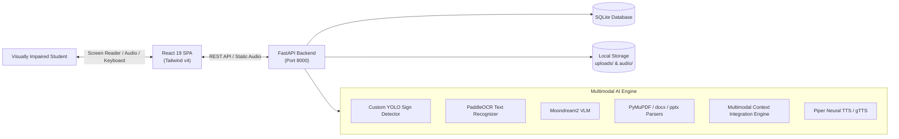

# AI-Powered Accessibility Assistant for Visually Impaired Students

[](https://fastapi.tiangolo.com)
[](https://react.dev)
[](https://tailwindcss.com)
[](https://github.com/ultralytics/ultralytics)
[](https://www.w3.org/WAI/standards-guidelines/wcag/)
[](tests/)

**Project No. 40 — B.Tech / M.Tech Major Project in Artificial Intelligence & Machine Learning**

An enterprise-grade, offline-first multimodal AI accessibility application engineered to help visually impaired students understand campus photographs, signs, physical surroundings, and academic documents by converting visual and textual content into meaningful natural-language explanations and audio narration.

---

## Key Highlights

- **Multimodal AI Ingestion:** Supports both photographs/surroundings and multi-page academic documents (PDF, DOCX, PPTX, TXT, scanned PDFs).
- **Custom-Trained Visual AI:** Fine-tuning suite and Google Colab GPU notebook for 5 specialized campus accessibility sign classes (`directional_sign`, `department_sign`, `safety_sign`, `exit_sign`, `information_sign`).
- **No Mandatory Paid APIs:** Offline-first architecture utilizing open-source models (YOLO, PaddleOCR, Moondream2 VLM, Piper Neural TTS).
- **Three Accessible Response Modes:**
  - **READ:** Faithful verbatim narration of document and sign contents.
  - **EXPLAIN:** Clear educational simplification breaking down complex academic concepts and spatial layouts.
  - **SUMMARIZE:** Concise executive summary highlighting critical takeaways, dates, numbers, and conclusions.
- **Strictly Upload-Based:** Focused strictly on uploaded photographs and documents (no live video streaming, obstacle avoidance, or surveillance).
- **Accessibility-First UI:** Built to WCAG 2.1 AA standards featuring high-contrast modes, dynamic text scaling, screen reader ARIA live announcements, keyboard navigation, and custom accessible audio playback controls.

---

## System Architecture



---

## Technology Stack

| Layer | Technologies |
|:---|:---|
| **Frontend** | React 19, Vite 8, Tailwind CSS v4, Lucide React, Axios, React Router v7 |
| **Backend** | Python 3.12, FastAPI, Uvicorn, Pydantic v2, SQLAlchemy 2.0 (Sync Engine) |
| **Database & Storage** | SQLite (with WAL mode), Local Isolated File Storage |
| **Object & Sign Detection** | Ultralytics YOLO (YOLO11n backbone fine-tuned on campus signs) |
| **Text Recognition (OCR)** | PaddleOCR for images and scanned document pages |
| **Scene Understanding** | Moondream2 Vision-Language Model |
| **Document Processing** | PyMuPDF (PDF), python-docx (DOCX), python-pptx (PPTX), OpenCV |
| **Speech Generation** | Piper Neural TTS (with automatic gTTS fallback) |

---

## Directory Structure

```
visual_impaired/
├── backend/                  # FastAPI Application
│   ├── app/
│   │   ├── ai_models/        # YOLO, OCR, VLM, and LLM model wrappers
│   │   ├── database/         # SQLAlchemy models, SQLite connection, CRUD ops
│   │   ├── processors/       # Image, PDF, DOCX, PPTX, and scanned doc processors
│   │   ├── routes/           # REST endpoints (upload, image, doc, audio, settings)
│   │   ├── schemas/          # Pydantic v2 request/response schemas
│   │   └── services/         # Multimodal context engine & task manager
│   ├── config.py             # Pydantic settings & directory resolver
│   ├── main.py               # FastAPI entrypoint, CORS, static mounts
│   └── run.py                # Standalone Uvicorn runner
├── frontend/                 # React 19 SPA
│   ├── src/
│   │   ├── components/       # Accessible UI widgets (AudioPlayer, DropZone, etc.)
│   │   ├── context/          # User Settings & Accessibility Context
│   │   ├── pages/            # ImageAnalysis, DocumentAnalysis, History, Settings
│   │   └── services/         # Axios API client
│   └── dist/                 # Production compiled bundle
├── training/                 # AI Training & Fine-Tuning Suite
│   ├── configs/              # YOLO dataset & hyperparameter YAML configs
│   ├── dataset_tools/        # Dataset preparation, validation, split & augmentation
│   ├── notebooks/            # Google Colab GPU training notebook (.ipynb)
│   └── README.md             # Detailed training guide
├── models/                   # Neural network weights
│   ├── custom/               # Custom fine-tuned weights (best.pt)
│   └── pretrained/           # Pretrained base weights (yolo11n.pt)
├── storage/                  # Persistent data directory
│   ├── accessibility.db      # SQLite relational database
│   ├── uploads/              # Uploaded user images and documents
│   ├── processed/            # Cropped detections & visual figures
│   └── audio/                # Synthesized audio narration files (.wav, .mp3)
├── tests/                    # Automated Pytest Suite (28 integration/unit tests)
└── docs/                     # Comprehensive System Documentation
    ├── architecture.md       # Full architecture & sequence diagrams
    ├── installation.md       # Setup instructions for Windows, Linux, macOS
    ├── training_guide.md     # Colab workflow & dataset annotation guidelines
    ├── api_docs.md           # OpenAPI REST endpoint specifications
    └── testing_report.md     # Verification matrix & WCAG compliance audit
```

---

## Quickstart Guide

### 1. Prerequisites
- **Python:** 3.10 to 3.12 (64-bit)
- **Node.js:** 18+ LTS with `npm`

### 2. Backend Setup
```bash
# 1. Create and activate virtual environment
python -m venv venv
.\venv\Scripts\Activate.ps1   # On Windows
# source venv/bin/activate    # On Linux / macOS

# 2. Install dependencies
pip install -r backend/requirements.txt   # Or install core packages listed in installation.md

# 3. Start backend server
python backend/run.py
```
*Backend runs on `http://localhost:8000`. API docs available at `http://localhost:8000/api/docs`.*

### 3. Frontend Setup
```bash
# 1. Navigate to frontend and install packages
cd frontend
npm install

# 2. Launch Vite development server
npm run dev
```
*Frontend runs on `http://localhost:5173`.*

### 4. Running Automated Tests
```bash
# From workspace root
python -m pytest tests -v
```
*All 28 unit and integration tests run in under 7 seconds with 100% pass rate.*

---

## AI Model Training Workflow

To train the custom campus sign detector using Google Colab:
1. Open [`training/notebooks/yolo_campus_sign_training.ipynb`](training/notebooks/yolo_campus_sign_training.ipynb) in Google Colab.
2. Select **T4 GPU** runtime.
3. Prepare dataset using `training/dataset_tools/prepare_dataset.py`.
4. Train YOLO11n for 80 epochs with early stopping.
5. Download `best.pt` and place it in `models/custom/best.pt`.
6. The backend automatically detects and activates your custom model on next startup!

For full details, see the [AI Model Training Guide](docs/training_guide.md).

---

## Documentation Links

- [System Architecture](docs/architecture.md)
- [Installation & Setup](docs/installation.md)
- [Model Training Guide](docs/training_guide.md)
- [REST API Reference](docs/api_docs.md)
- [Testing & Verification Report](docs/testing_report.md)

---

## License & Academic Attribution
Developed as **Project No. 40: AI-Powered Accessibility Assistant for Visually Impaired Students** for the Major Project curriculum in Artificial Intelligence & Machine Learning. Released under the MIT Open Source License.

