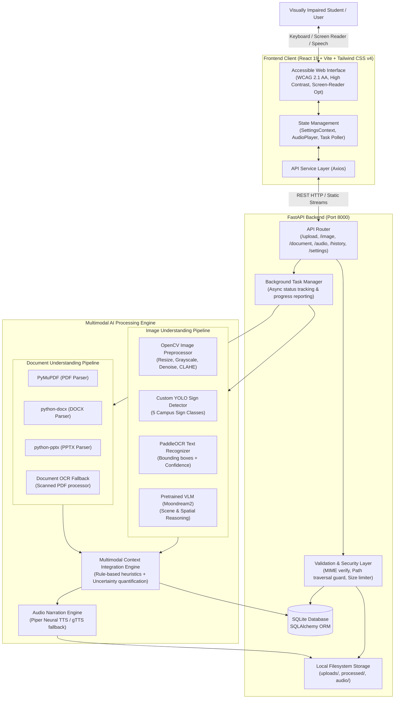
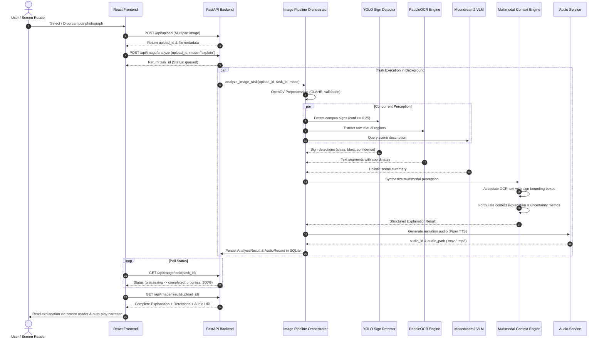

# System Architecture — AI-Powered Accessibility Assistant

## 1. Executive Architectural Overview

The **AI-Powered Accessibility Assistant for Visually Impaired Students** is an enterprise-grade, offline-first multimodal AI application. It is engineered to bridge visual barriers by ingesting uploaded photographs, environment captures, and academic documents, and converting them into context-aware natural language explanations and audio narration.

The system is strictly upload-driven, decoupled into an accessibility-focused React single-page application (SPA) and an asynchronous FastAPI backend powered by a hybrid AI stack.



---

## 2. Layered Architecture Specifications

### 2.1 Presentation Layer (Frontend)
- **Framework:** React 19.x with Vite 8.x for instant hot-module replacement and optimized asset tree-shaking.
- **Styling:** Tailwind CSS v4 using `@tailwindcss/vite` modern CSS architecture.
- **Accessibility Infrastructure (WCAG 2.1 AA Compliant):**
  - **Screen Reader Announcements:** Dedicated ARIA live regions (`aria-live="polite"` and `aria-live="assertive"`) that announce pipeline phase transitions (uploading, analyzing, narrating).
  - **High-Contrast Theme:** System-wide high-contrast toggle providing a minimum contrast ratio of 7:1 for text and visual indicators.
  - **Adjustable Typography:** User-controlled font scaling (`sm`, `md`, `lg`, `xl`) persisted to user settings.
  - **Keyboard Navigation:** Full keyboard operability with prominent focus rings (`focus-visible:ring-2 focus-visible:ring-primary-500 focus-visible:ring-offset-2`).
  - **Accessible Audio Player:** Custom player with playback rate toggles (0.75x, 1.0x, 1.25x, 1.5x), rewind/fast-forward buttons, accessible scrubber, and live time updates.

### 2.2 Application Services Layer (Backend)
- **Framework:** FastAPI running on Uvicorn with asynchronous endpoints and background task distribution.
- **Synchronous ORM Layer:** SQLAlchemy 2.0 with synchronous connection pooling (`connect_args={"check_same_thread": False}`). This design eliminates Windows asyncio proactor event-loop deadlocks while delivering sub-millisecond database queries.
- **Data Validation & Typing:** Pydantic v2 schemas enforcing strict request validation and response serialization.
- **Static Asset Serving:** Built-in FastAPI `StaticFiles` mounting for streamed audio files (`/static/audio/`) and uploaded image previews (`/static/uploads/`).

---

## 3. Multimodal AI Architecture & Processing Pipelines

### 3.1 Image Understanding Pipeline

The image pipeline executes in 10 deterministic stages to prevent hallucinations and clearly distinguish detected ground truth from model inferences:



#### Perception Modules:
1. **Ultralytics YOLO (Fine-tuned):** Scans the image for campus-specific accessibility visual anchors across 5 classes:
   - `directional_sign`
   - `department_sign`
   - `safety_sign`
   - `exit_sign`
   - `information_sign`
2. **PaddleOCR Engine:** Extracts text lines and calculates transcription confidence.
3. **Moondream2 VLM:** Operates as the scene context engine, describing environmental attributes, lighting, people, and architectural layouts.
4. **Multimodal Context Integration Engine:** Performs spatial IoU intersection between OCR text bounding boxes and YOLO sign bounding boxes. It correlates which text belongs to which sign, generates plain-language navigation guidance, flags uncertain detections (e.g. low-confidence signs or blurry text), and produces structured output.

### 3.2 Document Understanding Pipeline

The document pipeline processes multi-page academic materials with dual-track structural extraction:
1. **Native Text Stream:** Extracts hierarchical headings, paragraphs, bullet lists, page numbers, and tabular data using PyMuPDF (PDF), python-docx (DOCX), and python-pptx (PPTX).
2. **Visual Content Stream:** Extracts embedded figures, diagrams, charts, and illustrations from document bodies, associating each visual asset with its parent page or slide.
3. **Scanned PDF Fallback:** Automatically detects scanned or image-only documents and invokes high-resolution OCR with layout preservation.
4. **Three Accessible Response Modes:**
   - **READ Mode:** Faithful, sequential read-aloud of the document text and table contents.
   - **EXPLAIN Mode:** Educational simplification breaking down academic concepts, summarizing tables, and clarifying diagrams.
   - **SUMMARIZE Mode:** Concise executive brief highlighting key findings, critical dates, statistical figures, and conclusions.

---

## 4. Storage Architecture

```
storage/
├── accessibility.db       # SQLite transactional relational store
├── uploads/               # Original uploaded images and documents (UUID namespaced)
├── processed/             # Cropped signs, visual extracts, intermediate artifacts
└── audio/                 # Generated audio narration files (.wav, .mp3)
```

### Relational Schema (SQLite + SQLAlchemy):
- **`uploads`**: Tracks unique upload ID, sanitized filename, original filename, MIME type, file size, storage path, status, and timestamps.
- **`analysis_results`**: Stores image analysis results, including detected signs JSON, OCR text JSON, scene descriptions, multimodal explanation text, confidence metrics, and audio reference.
- **`document_results`**: Stores extracted document structure, page count, headings JSON, tables JSON, visual metadata JSON, generated explanation/summary, and audio reference.
- **`audio_records`**: Maps audio ID to file path, duration, voice model, speech speed, and parent upload.
- **`user_settings`**: Stores individual accessibility preferences (speech speed, voice, text size, contrast, screen reader mode, retention).

---

## 5. Security & Reliability Architecture

1. **Path Traversal Protection:** All file storage operations resolve strict absolute paths under the configured root directory. Attempted `..` or illegal characters are rejected with `HTTP 400 Bad Request`.
2. **Filename Sanitization:** User filenames are stripped of non-alphanumeric characters, checked for length, and assigned unique UUID prefixes to prevent file collision and execution vulnerabilities.
3. **MIME & Magic Header Validation:** Incoming files undergo strict extension and MIME verification. Executables and unapproved formats are rejected.
4. **Lazy AI Model Loading:** AI weights are decoupled from health checks and database operations. The FastAPI server boots in milliseconds, loading neural network weights into memory only upon the first inference request.
5. **Graceful Fallbacks:** If an optional model (such as an external LLM or local Piper binary) is unavailable, the system automatically falls back to deterministic rule-based explanations and gTTS speech synthesis without raising 500 errors.

